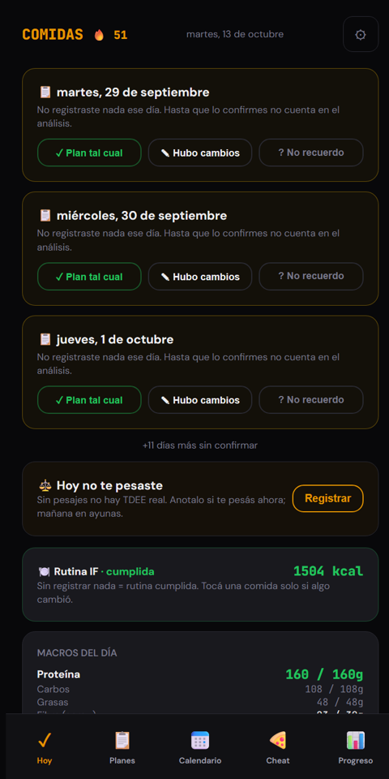

# Comidas - Meal and Weight Tracker

A personal, offline-first PWA for following a fixed meal plan, logging deviations, and measuring the real calorie deficit against body-weight trends.

**Live app:** https://jhk212.github.io/Alimentacion-tracker/



## Features

- **Exception-based tracking** - each day defaults to the active meal routine; you only log what changed (skipped meal, alternative, different dish, partial portion, cheat, or snack).
- **Pending-day confirmation** - past days with no interaction must be confirmed ("plan as is", "there were changes", or "don't remember") so forgotten days are not counted as perfect adherence.
- **Date-versioned meal plans** - a new routine takes effect from a given date without rewriting the calorie history of earlier days. Plans are editable, with per-meal macros, alternatives, components, supplements, and approximate fiber.
- **Dish catalog and recipe book** - pick a replacement meal from a built-in catalog or your own recipes; recipes can be created manually or imported from a screenshot via an AI model.
- **Weekly meal prep** - pin a recipe as the default for lunch or dinner for 7 days.
- **Cheats and snacks** - quick-add presets, timestamps, a weekly cheat calorie budget, and an optional AI calorie estimator that can ask one follow-up question to refine its estimate.
- **Calendar** - monthly view with day status, cheat/weight/photo badges, meal-prep streaks, and a per-day detail modal.
- **Progress and deficit analysis** - weight log with an interactive chart, regression-based weekly trend, Mifflin-St Jeor TDEE estimate, and a 28-day window comparing intake, expected loss, and actual loss (with a self-calibrated TDEE).
- **Extras** - streak counter with milestone celebrations, weekly check-in (strength, energy, hunger, sleep, mood), progress-photo dates, creatine loading window (excluded from weight trend), daily weigh-in reminder.
- **Data ownership** - JSON export/import, backup reminder after 30 days, bulk deletion of days, and a copyable plain-text 28-day summary for external analysis.

## How it works

- **Single HTML file**: all markup, CSS, and vanilla JavaScript live in `index.html`. No framework, no build step, no dependencies.
- **Storage**: everything is kept in the browser's `localStorage` (keys prefixed `food-`). There is no backend and no login; data stays on the device unless exported.
- **Migrations**: a `PLANS_REV` counter with patch functions updates stored meal plans on load without discarding user edits.
- **Offline / PWA**: `sw.js` is a network-first service worker that falls back to the cache when offline. The web manifest and icon are generated at runtime (canvas + blob URL), so the app can be installed to the home screen.
- **Optional AI estimator**: if an API key is entered in Settings, the app calls Google Gemini (`generativelanguage.googleapis.com`) or OpenRouter (when the key starts with `sk-or`) to estimate calories and to parse recipe screenshots. Models fall back through a list on errors. The key is stored only in `localStorage`. Without a key, the feature is hidden and everything works manually.

## Tech stack

- HTML, CSS, vanilla JavaScript (ES2020+)
- Web Storage API (`localStorage`)
- Service Worker + runtime-generated Web App Manifest
- Google Fonts (DM Sans, JetBrains Mono)
- Optional: Google Gemini API or OpenRouter API
- Hosted on GitHub Pages

## Run locally

Service workers require `http://` (not `file://`), so serve the folder with any static server:

```bash
git clone https://github.com/JHK212/Alimentacion-tracker.git
cd Alimentacion-tracker
python -m http.server 8000
```

Then open http://localhost:8000. The layout is mobile-first (max width 480 px); use a phone or the browser's device emulation.

## Project structure

```
Alimentacion-tracker/
├── index.html   # The entire app: markup, styles, logic, default meal plans
├── sw.js        # Service worker (network-first with cache fallback)
└── CLAUDE.md    # Internal developer notes (Spanish): data model, storage keys, conventions
```

## Notes

- The UI is in Spanish (Argentina), including food presets and dish names.
- The default meal routines, dish catalog, and presets are tailored to one person's diet; adapt them in the Plans screen or in `index.html`.
- When deploying changes, bump the cache name in `sw.js` (and the version shown in Settings) so installed clients pick up the new version.
